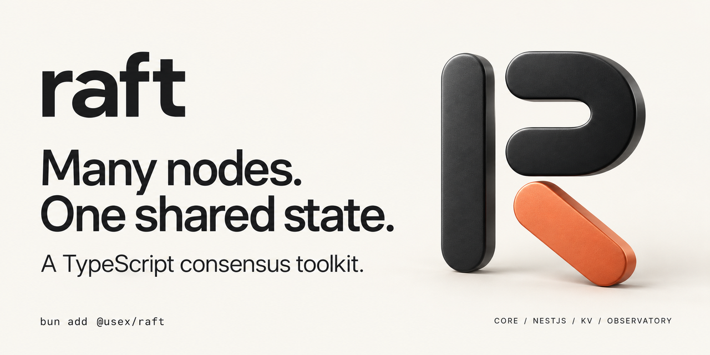

# Raft visual identity

**Many nodes. One shared state.**

The **Quorum mark** brings three independent shapes into one recognizable R: an upright, an open bowl, and an ember-colored diagonal. Their separation suggests independent members; their alignment suggests agreement. It is a brand metaphor, not a topology diagram or a claim about a three-node quorum.



## Files

| Asset                                            | Format / size           | Use                                                                  |
| ------------------------------------------------ | ----------------------- | -------------------------------------------------------------------- |
| [Primary logo](./logo.svg)                       | SVG · 512 × 512 viewBox | Graphite tile; works on light and dark pages                         |
| [Primary logo PNG](./logo.png)                   | PNG · 512 × 512         | Exact raster export of the primary SVG; transparent outside the tile |
| [Mark for light backgrounds](./logo-alt.svg)     | SVG · transparent       | Graphite and ember mark                                              |
| [Mark for dark backgrounds](./logo-abstract.svg) | SVG · transparent       | Porcelain and ember mark                                             |
| [Single-color mark](./logo-creative.svg)         | SVG · transparent       | Ember mark for one-color applications                                |
| [KV compatibility logo](./kv-server-logo.svg)    | SVG · 512 × 512 viewBox | Same primary mark; keeps existing KV documentation links working     |
| [Social preview](./social-preview.png)           | PNG · 1280 × 640        | Finished studio-rendered repository/share cover                      |
| [Social vector companion](./social-preview.svg)  | SVG · 1280 × 640        | Editable flat composition with the same mark and copy                |
| [Project landing page](./index.html)              | HTML + CSS + JavaScript | Interactive introduction, package directory, and dashboard film      |
| [Observatory film](./raft-observatory.mp4)         | MP4 · 1920 × 1080 · 60 s | Live five-node dashboard tour                                        |
| [Film poster](./observatory-poster.jpg)           | JPEG · 1920 × 1080      | Still extracted from the Observatory film                            |

The older variant filenames remain available to preserve links. They now belong to one identity; they are no longer unrelated alternate logo concepts. All package README headers use the primary mark. The root README uses the social preview.

The PNG social cover includes generated three-dimensional materials and light. The SVG companion is native vector artwork rather than an embedded bitmap; it deliberately uses a flat rendition. Neither file depends on external images, stylesheets, or fonts. The SVG's live text uses a local system font stack, so letterforms may vary between renderers. Use the PNG when exact typography is required.

## Landing page

Open `index.html` directly in a browser, or serve this directory with a static HTTP server. Keep `landing.css`, `landing.js`, the logo files, the film, and its poster beside it. There is no build step, CDN, external font, or additional dependency.

The five-node sculpture is an explicitly labeled illustration; choosing a node changes the illustrated leader without contacting the real dashboard. The embedded video is the real five-node capture. Motion can be paused and respects the system's reduced-motion preference. The installation tabs support keyboard navigation; documentation links, native video playback, and the initial commands remain available without JavaScript.

## Palette

| Color     | Hex       | Role                            |
| --------- | --------- | ------------------------------- |
| Graphite  | `#1B1C1E` | Primary mark, text, icon tile   |
| Porcelain | `#F5F2EB` | Light surface and reversed mark |
| Ember     | `#ED805E` | The diagonal decision stroke    |

Use the supplied two-color mark for primary communication. Use the single-color variant where color reproduction is limited. The geometry does not rely on a gradient, blur, or shadow to remain recognizable.

## Scale and space

- Display the tile at **32 px or larger**. README headers use 88 px.
- Keep clear space around a standalone mark of at least one stroke width: **64 units in its 512-unit viewBox**.
- Preserve the gaps between the three parts and scale proportionally.
- Use graphite on light surfaces and porcelain on dark surfaces. Avoid low-contrast backgrounds.
- Keep the social image at its **2:1 aspect ratio**. Use the PNG for repository social-preview uploads and raster-only consumers.
- Do not add crowns, network connectors, extra nodes, gradients, or a fourth piece to the logo.

## Typography and copy

Use a quiet system sans-serif stack for documentation: `-apple-system, BlinkMacSystemFont, "Segoe UI", sans-serif`. The vector social composition uses Helvetica Neue, Helvetica, and Arial; installation commands use a monospace stack.

- Product name: **Raft**; the social wordmark is lowercase **raft**.
- Brand line: **Many nodes. One shared state.**
- Description: **A TypeScript consensus toolkit.**
- Developer entry point: **bun add @usex/raft**.
- Package family: **Core / NestJS / KV / Observatory**.

The brand line describes the project's purpose. It is not a durability or conformance guarantee. Documentation links to the [current audit](../docs/raft-spec-audit.md); avoid unverified production-readiness, performance, or coverage claims.

## Creation and source

The logo and vector companion are editable SVG source. `logo.png` is rendered from `logo.svg`. The three-dimensional social cover was created with the built-in **imagegen** tool, using the primary mark as the identity reference, and exported at 1280 × 640. No runtime or package dependency was added.

The prompt used for the social cover is included below so future revisions preserve the same art direction and constraints.

## License

These assets are distributed under the repository's [MIT license](../LICENCE). Use the supplied files when referring to this project; do not imply an endorsement by Apple or another company.

Updated October 19, 2026.

<details>
<summary>Social cover generation prompt</summary>

```text
Use case: logo-brand
Asset type: final repository social preview for the Raft TypeScript consensus toolkit, landscape 2:1 composition, 1280 by 640.
Primary request: Create an exceptionally refined minimal technology brand cover. Use the attached new Raft mark exactly as the brand identity. This is a professional identity system, premium industrial design and immaculate editorial typography.
Input image: The supplied image is the exact Raft emblem. It has THREE disconnected solid components: a tall rounded upright, a thick rounded right bowl opening left, and a short diagonal orange leg, together reading as R. Preserve the number, silhouette, roundness and relative placement of these three pieces. Do not introduce a different logo. Remove its enclosing app-icon tile in the 3D rendition.
Scene/backdrop: seamless very pale warm ivory studio, #F5F2EB. A very soft warm-gray contact shadow, generous empty space, no seams.
Subject: on the RIGHT, the exact three-part R mark rendered as a large freestanding precision sculpture. Stem and upper bowl are matte graphite ceramic (#1B1C1E); diagonal leg is satin anodized copper-orange (#ED805E). Very shallow extrusion and tiny rounded bevels, crisp silhouette, gentle camera perspective, fully visible, with no overlaps between parts. Quiet soft directional light, realistic material, no chrome, no rainbow.
Composition: exact wide 2:1 canvas. Left 54 percent reserved for typography, right 40 percent contains the sculpture. Broad 72px safe margin all around. No part touches the edges.
Text verbatim on LEFT: lowercase wordmark "raft" near upper left, elegant large confident sans-serif with tight professional kerning. Below, large two-line headline "Many nodes." then "One shared state." Under that, smaller readable "A TypeScript consensus toolkit." At bottom left, small monospace "bun add @usex/raft". At bottom right, small text "CORE / NESTJS / KV / OBSERVATORY".
Typography: exceptional precision, dark graphite, contemporary Swiss grotesk, no decorative fonts. The tagline is prominent and uncluttered. Exact spelling and casing, no extra text, no watermark, no Apple logo, no UI controls, no badges, no border, no mesh gradients, no circuit lines or network dots. The result is the finished social card, not a mockup shown on a device.
```

</details>
